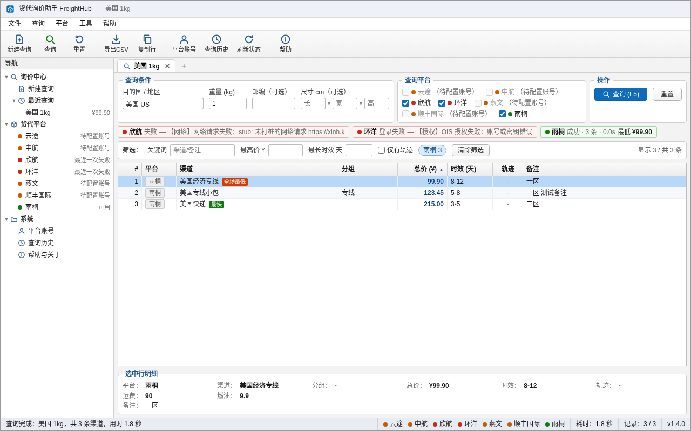
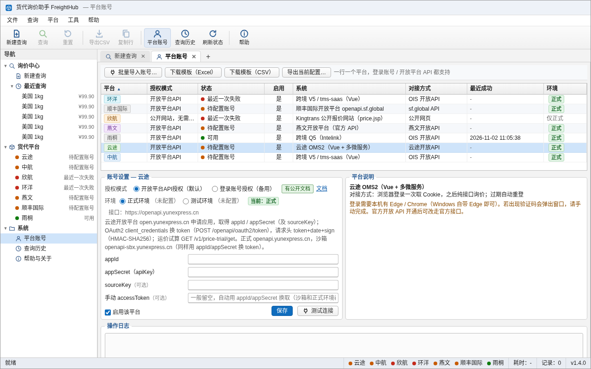
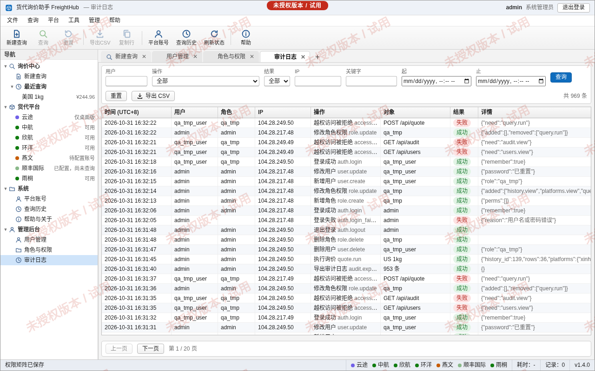

# FreightHub

**20261102** · 货代询价与运价工作台：包含 Web 应用和浏览器扩展，用于查询、比价、账户与审计。

## 界面截图



*询价查询 / Quote query*



*账户 / Accounts*



*审计记录 / Audit log*


*扩展侧栏结果 / Extension side panel results*

## 功能特性

- Web / 桌面询价界面：查询、账户、导入预览。
- 浏览器扩展：侧栏展示实时结果、历史、快捷桌面入口与选项页。
- 核心服务在 `freight-hub/`，扩展在 `freight-hub-extension/`，Web 在 `freight-hub-web/`。

## 技术栈

- Python（核心服务）
- Web 前端 + 浏览器扩展

## 从源码运行

源码在仓库根目录。请先阅读 `freight-hub/README.md` 与根目录附近的说明文件，按其中步骤安装依赖并启动服务与前端。本仓库不包含安装包，也不包含任何密钥或凭据。

```bash
cd freight-hub
# 按该目录 README 安装 Python 依赖并启动
```
## 文档

- [核心服务](freight-hub/README.md)
- [Web](freight-hub-web/README.md)
- [浏览器扩展](freight-hub-extension/README.md)
- [说明](说明-先看我.md)

---

## English

# FreightHub

**20261102** · A freight-forwarding rate and inquiry workbench: a web app plus a browser extension for quotes, comparison, accounts, and audit trails.

## Screenshots


*询价查询 / Quote query*


*账户 / Accounts*


*审计记录 / Audit log*


*扩展侧栏结果 / Extension side panel results*

## Features

- Web / desktop inquiry UI: queries, accounts, and import preview.
- Browser extension: live results, history, quick desktop actions, and an options page.
- Core service in `freight-hub/`, extension in `freight-hub-extension/`, web app in `freight-hub-web/`.

## Tech stack

- Python（核心服务）
- Web 前端 + 浏览器扩展

## Getting started

Source is at the repository root. Follow `freight-hub/README.md` (and the sibling notes) to install dependencies and start the service and UI. This repository does not include installers or credentials.

```bash
cd freight-hub
# Install Python dependencies and start the service as that README describes
```
## Documentation

- [核心服务](freight-hub/README.md)
- [Web](freight-hub-web/README.md)
- [浏览器扩展](freight-hub-extension/README.md)
- [说明](说明-先看我.md)

